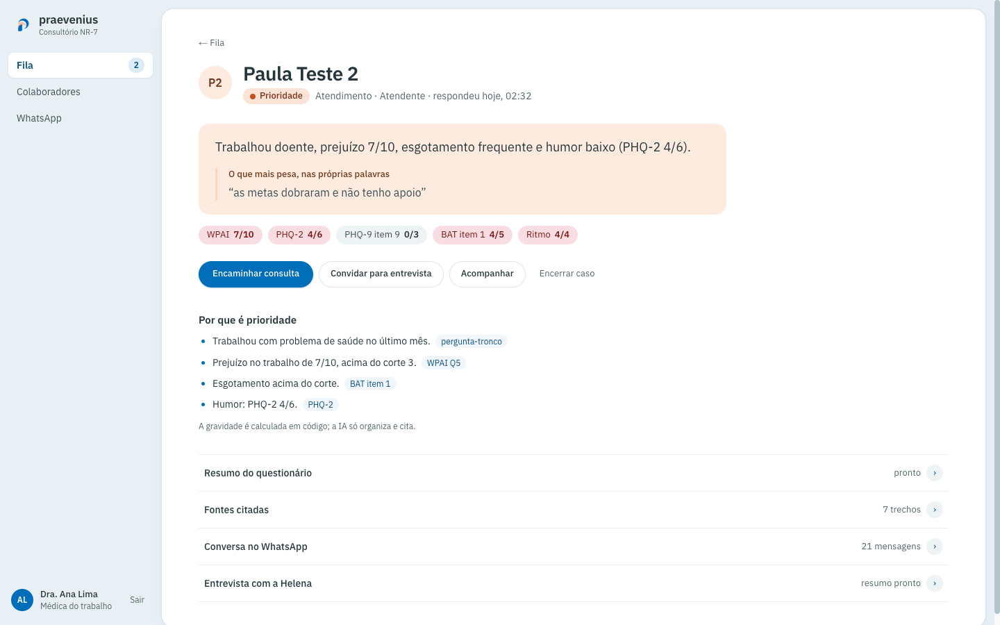
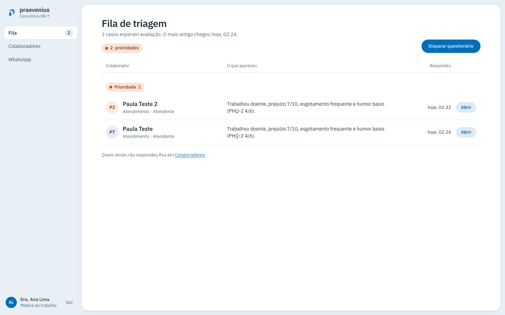
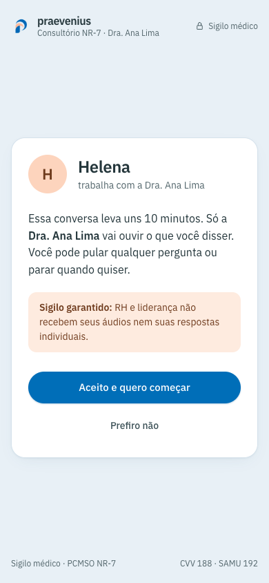
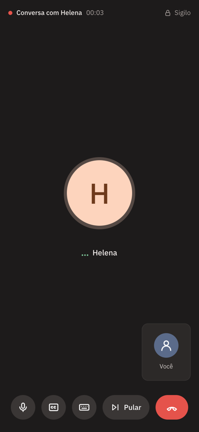
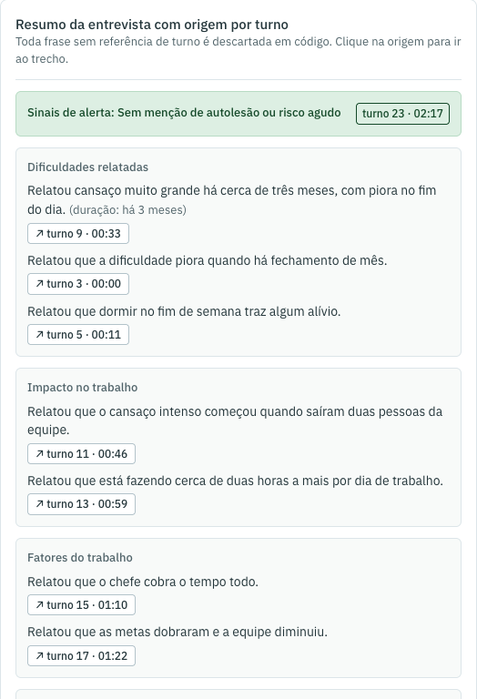

<h1 align="center">
  <br>
  Consultório NR-7
</h1>

<p align="center">
  O médico do trabalho acompanha os colaboradores por questionários validados no WhatsApp<br>
  e por uma entrevista curta por voz, e vê quem merece atenção, sempre com a fonte de cada indício.
</p>

<p align="center">
  <a href="#como-funciona"><b>Como funciona</b></a> ·
  <a href="#rodar-local"><b>Rodar local</b></a> ·
  <a href="#entrevista-por-voz"><b>Entrevista por voz</b></a> ·
  <a href="#documentação"><b>Documentação</b></a>
</p>

<p align="center">
  
</p>

Produto **praevenius**, feito no Converge Challenge (Recife, 7 e 8 de novembro de 2026).

## Por quê

Desde 26/05/2026 a NR-1 obriga toda empresa a gerenciar riscos psicossociais, e as multas valem desde 24/09/2026. É na NR-7 (PCMSO) que o médico do trabalho usa esses sinais pessoa a pessoa. Hoje isso costuma ser um formulário em papel ou uma planilha, uma vez por ano e sem acompanhamento.

O Consultório NR-7 leva o questionário para o WhatsApp, que todo colaborador já usa, calcula em código quem precisa de atenção e entrega ao médico uma fila por gravidade. Quando há indício, uma entrevista por voz com a Helena aprofunda o relato, e o resumo dela cita o minuto exato de cada frase.

## Como funciona

1. **Conexão.** O médico lê um QR Code com o celular do consultório, que passa a ser o número que envia as mensagens.
2. **Questionário pelo WhatsApp.** O médico cadastra os colaboradores (um a um ou por CSV) e dispara o questionário. O bot faz uma pergunta por mensagem e aceita número ou texto curto.
3. **Fila por gravidade.** Cada resposta é pontuada em código. Quem tem indício entra na fila como Urgência, Prioridade ou Atenção, com uma frase que explica o porquê.
4. **Caso.** Escores, motivos com a fonte, resumo, conversa e trechos da base de conhecimento (NR-1, NR-7, manuais dos instrumentos). Daqui o médico encaminha, acompanha ou convida para a entrevista.
5. **Entrevista por voz.** O colaborador abre o convite no celular e conversa uns 10 minutos com a Helena. O resumo volta para o Caso, com a origem de cada frase.

<p align="center">
  
</p>

## Regras que não mudam

- **Não é diagnóstico.** O sistema fala em "indício", "sinal" e "relatou". "Você tem", "burnout", "depressão" e "transtorno" são bloqueados em código.
- **Crise é cortada em código, antes de qualquer IA.** Uma frase de risco, ou o item 9 do PHQ-9 acima de zero, interrompe a conversa, mostra o CVV 188 e o SAMU 192 e coloca o caso como Urgência no topo da fila.
- **Pontuação e gravidade são calculadas em código.** A IA só organiza, explica e resume.
- **Nenhum indício aparece sem a fonte.** Ou o item do instrumento, ou o trecho da norma, ou o turno da entrevista.
- **Só o médico vê o indivíduo.** RH e liderança não recebem respostas nem áudios individuais.
- **A demo usa dados sintéticos.** Telefone real, só o do time.

### Gravidade

| Nível | Quando |
|---|---|
| Urgência | Item 9 do PHQ-9 acima de zero, ou frase de risco em qualquer mensagem |
| Prioridade | Sofrimento (BAT-12 ≥ 2,54, PHQ-9 ≥ 10 ou GAD-7 ≥ 10) junto com presenteísmo ou prejuízo no trabalho, ou sofrimento grave sozinho |
| Atenção | Presenteísmo com prejuízo no trabalho, sofrimento sozinho, ou relato de assédio |
| Sem indício | Nenhum dos anteriores |

### Questionário

Só instrumentos validados no Brasil e de uso livre, com o texto original. Detalhes e fontes em [docs/questionario-whatsapp.md](docs/questionario-whatsapp.md).

| Bloco | Instrumento | Para quê |
|---|---|---|
| Presenteísmo | Pergunta-tronco e WPAI Q5 (prejuízo de 0 a 10) | Se o problema de saúde atrapalha o trabalho |
| Humor | PHQ-2, que abre o PHQ-9 se der positivo; o item 9 é sempre perguntado | Rastreio de depressão e segurança |
| Ansiedade | GAD-2, que abre o GAD-7 se der positivo | Rastreio de ansiedade |
| Cansaço no trabalho | BAT-12 | Esgotamento ligado ao trabalho |
| Ambiente de trabalho | COPSOQ II-Br: ritmo, influência, apoio da chefia, assédio | O porquê no trabalho, foco da NR-1 |
| Abertas | O que está mais difícil? O que ajudaria? | A voz do colaborador |

## Entrevista por voz

<p align="center">
  
  &nbsp;
  
</p>

A Helena é a entrevistadora de IA. A conversa acontece numa tela de chamada própria, no navegador do celular, sem instalar nada:

- **Consentimento antes de tudo.** Se a pessoa disser "Prefiro não", nada é gravado.
- **Como uma ligação.** O microfone abre sozinho quando a Helena termina de falar e fecha depois de 1,8 s de silêncio. Não há botão "Pronto".
- **Escuta de verdade.** A Helena reage ao que a pessoa contou ("Hmm, entendi") e responde quando perguntam "você entendeu?".
- **Sem resposta clara, a pergunta volta de outro jeito.** Diante de "não sei", "às vezes" ou de uma recusa, a Helena refaz a pergunta com outras palavras. Se ainda assim não houver resposta, o relatório do médico ganha um aviso.
- **Pular e sair estão sempre à vista.** "Pular pergunta" fica ao lado do microfone; o botão vermelho encerra, depois de uma confirmação.
- **A pauta sai dos escores.** O motor monta a pauta a partir do questionário. São no máximo 12 turnos ou 15 minutos, e sempre sobra um turno para a pergunta de segurança.

<p align="center">
  
</p>

No Caso, o médico vê a transcrição turno a turno, com o áudio de cada resposta, e o resumo. Frase do resumo sem turno de origem é descartada em código.

**Como a voz funciona.** Quem decide é o motor, em código. A IA de texto só extrai os achados, escreve a reação e o resumo. A fala é sintetizada pela ElevenLabs (voz Bella, `eleven_flash_v2_5`) ou pelo [Voicebox](https://github.com/jamiepine/voicebox) local; a escuta é o Whisper do Voicebox. As falas fixas ficam em cache no disco, então a cota só é gasta com as reações novas. Medições em [docs/medicoes-voz.md](docs/medicoes-voz.md).

## Rodar local

Precisa de Docker, Node 20+ e pnpm.

```bash
cp .env.example .env
docker compose up -d        # Postgres + pgvector :5434, Redis :6380, Evolution API :8082
pnpm install
pnpm db:push                # cria as tabelas
pnpm ingest                 # carrega a base de conhecimento (NR-1, NR-7, manuais)
pnpm dev                    # http://localhost:3100
```

O login é de demonstração: qualquer e-mail e senha entram. A IA começa em modo simulado (`AI_PROVIDER=mock`) e a voz desligada (`VOICE_PROVIDER=none`), então tudo roda sem chave nenhuma.

### Ligar a IA real

```bash
# 1. preencha AI_GATEWAY_API_KEY no .env
pnpm ai:check      # confere embeddings (1536 dimensões) e chat em menos de um minuto
# 2. troque AI_PROVIDER=mock por AI_PROVIDER=gateway no .env
pnpm ingest        # refaz os vetores da base com o modelo real
pnpm evals         # confere origem, termos e crise com a IA real
```

### Ligar a voz

Abra o Voicebox e aqueça o Whisper primeiro. Depois:

```bash
# .env: VOICE_PROVIDER=elevenlabs, ELEVENLABS_API_KEY, ELEVENLABS_VOICE_ID (ou VOICE_PROVIDER=voicebox)
pnpm voz:pregerar --contar           # quantos caracteres faltam gerar
pnpm voz:pregerar                    # grava o áudio das falas fixas em data/voz/
pnpm entrevista:convite --fixture prioridade   # imprime um link /entrevista/<token>
```

O passo a passo completo, inclusive como testar no celular (o microfone exige HTTPS), está em [docs/entrevista-como-ver.md](docs/entrevista-como-ver.md).

## Variáveis de ambiente

Veja `.env.example`. As principais:

| Variável | Para quê |
|---|---|
| `DATABASE_URL`, `TEST_DATABASE_URL` | Postgres do app e dos testes (o do `docker compose`, porta 5434) |
| `EVOLUTION_URL`, `EVOLUTION_API_KEY`, `EVOLUTION_INSTANCE` | Evolution API, que conecta o celular do consultório ao WhatsApp |
| `WEBHOOK_SECRET`, `APP_PUBLIC_URL` | Webhook que recebe as mensagens; a URL precisa ser alcançável pelo contêiner da Evolution |
| `WHATSAPP_DRY_RUN` | `true` não envia nada de verdade (bom para testar sem celular) |
| `AI_PROVIDER` | `mock` (padrão) ou `gateway` |
| `AI_GATEWAY_API_KEY`, `AI_CHAT_MODEL`, `AI_EMBEDDING_MODEL` | Chave e modelos da IA real |
| `DEMO_SHORT` | `true` usa o questionário curto da demo (8 itens) |
| `DOCTOR_NAME` | Nome do médico que aparece para o colaborador |
| `VOICE_PROVIDER` | `none`, `voicebox` ou `elevenlabs` |
| `VOICEBOX_URL`, `VOICEBOX_PROFILE_ID`, `VOICEBOX_ENGINE`, `VOICEBOX_STT_MODEL` | Voicebox local (fala e/ou escuta) |
| `ELEVENLABS_API_KEY`, `ELEVENLABS_VOICE_ID`, `ELEVENLABS_MODEL` | Voz da Helena na ElevenLabs |
| `INTERVIEW_MODE` | `live` (gera reações novas) ou `cache_only` (só falas gravadas) |
| `INTERVIEW_PUBLIC_URL` | Endereço usado nos convites da entrevista |

## Comandos

| Comando | O que faz |
|---|---|
| `pnpm dev` | Servidor de desenvolvimento na porta 3100 |
| `pnpm test` | Testes (Vitest) |
| `pnpm lint` | ESLint |
| `pnpm db:push` | Aplica o schema no banco |
| `pnpm ingest` | Carrega e vetoriza a base de conhecimento de `knowledge/` |
| `pnpm evals` | Checagens de segurança do questionário: origem, termos proibidos e crise |
| `pnpm evals:entrevista` | Checagens da entrevista: crise 100%, nenhum termo proibido ou conselho, nenhum resumo sem origem |
| `pnpm ai:check` | Confere se a chave da IA real funciona |
| `pnpm entrevista:db` | Cria só as tabelas da entrevista |
| `pnpm entrevista:convite` | Cria um convite de entrevista e imprime o link |
| `pnpm voz:pregerar` | Gera o áudio das falas fixas da Helena |
| `pnpm voz:medir` | Mede a latência da voz e grava em `docs/medicoes-voz.md` |
| `pnpm voz:cota` | Mostra os créditos que restam na ElevenLabs |

## Stack

Next.js 16 (App Router), React 19, TypeScript, Tailwind 4, Drizzle ORM com Postgres e pgvector, Redis, Evolution API (WhatsApp) em Docker, AI SDK, zod e Vitest. Voz com ElevenLabs e Voicebox (Whisper).

## Estrutura

```
src/
  app/(app)/          telas do médico: fila, caso, contatos, conexão
  app/entrevista/     sala da entrevista do colaborador
  app/api/            rotas do médico, da entrevista e o webhook do WhatsApp
  lib/instruments/    itens, pontuação e gravidade
  lib/crisis/         detector de crise
  lib/engine/         motor do questionário
  lib/interview/      motor da entrevista: pauta, filtros, resumo com origem
  lib/voice/          fala e escuta (ElevenLabs, Voicebox)
  lib/rag/, evidence/ base de conhecimento e indícios com fonte
knowledge/            documentos de origem (normas e manuais)
evals/, scripts/      checagens de segurança e utilitários
```

## Documentação

- Produto e público: [PRODUCT.md](PRODUCT.md)
- Sistema visual "Prontuário em ordem": [DESIGN.md](DESIGN.md)
- Roadmap: [docs/ROADMAP.md](docs/ROADMAP.md)
- Questionário e instrumentos: [docs/questionario-whatsapp.md](docs/questionario-whatsapp.md)
- Fontes da base de conhecimento: [docs/fontes-base-de-conhecimento.md](docs/fontes-base-de-conhecimento.md)
- Entrevista por voz, como rodar e ver: [docs/entrevista-como-ver.md](docs/entrevista-como-ver.md)
- Desenho e planos: [docs/superpowers/](docs/superpowers/)

## Ajuda em crise

Este sistema não substitui atendimento. Se você ou alguém perto de você está em risco, ligue para o **CVV 188** (24 horas, gratuito) ou para o **SAMU 192**.
